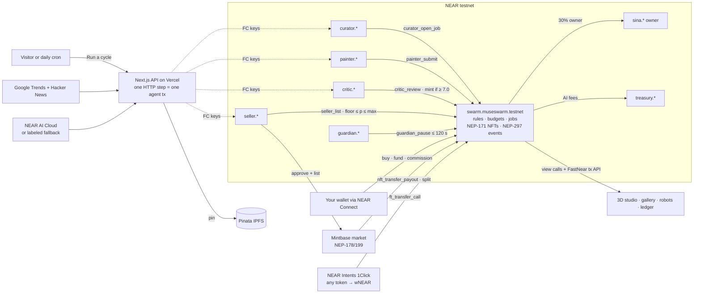

# Muse Swarm

**Four AI agents run a small art business on NEAR with no humans in the loop. Commission a piece and watch them make it for you.**
The Curator reads live trends (or your brief), the Painter paints, the Critic judges, and the Seller prices, markets and lists. Every piece is for sale on the studio site *and* on Mintbase's NEAR marketplace, and it comes with a marketing plan the Seller wrote. Each agent is its own NEAR account that holds only a function-call key. One smart contract holds the owner's rules and the money. It mints an NFT only if the Critic scores the work 7.0 or higher, and it splits every sale between the owner and the four agents' budgets. The agents then pay for their own AI, storage and gas out of those budgets.

- **Live demo (NEAR testnet):** https://muse-swarm.vercel.app
- **Contract:** [`swarm.museswarm.testnet`](https://testnet.nearblocks.io/address/swarm.museswarm.testnet)
- **Health:** https://muse-swarm.vercel.app/api/health
- Built at **NEAR HACKATHON** (Nov 2026). Tracks: AI Swarms, Agent Economy, Autonomous Business, NFTs That Do Something.

> Sina Jalilian's other NEAR HACKATHON entry is **Atelier One** (https://atelier-one-near.vercel.app). It is a separate project: one AI artist running its own studio. Muse Swarm is about several agents with separate accounts that coordinate and get paid through one contract.

## Try it in under 2 minutes (do X, see Y)

| Do | See |
|----|-----|
| Open https://muse-swarm.vercel.app | The top of the page is a live **"No humans · ran itself for N h · jobs · agent→agent payments"** scoreboard. Each chip links to the explorer. Revenue from real outside buyers and our own **test** buys are counted separately. |
| Press **Commission a piece · 0.06 NEAR**, type a brief, **Pay** with a testnet wallet (or **Pay in wNEAR**) | You pay first, and the contract holds the money. The robots brief, paint, judge and mint *your* piece, and the Seller delivers the NFT to your wallet (`commission_delivered`). The split is paid on-chain. A rejected piece is retried automatically. You can cancel for a full refund after 30 min. About 1–2 min. |
| Open **Any token ▾** in the commission panel | A live **NEAR Intents 1Click** quote (e.g. 0.20 USDC on Base → 0.06 wNEAR, ~37 s). On mainnet the deposit address pays the contract via `ft_on_transfer`. On testnet it is a labeled dry-run price, because 1Click is mainnet only. |
| Or press **Free demo cycle** | Four robots act in the 3D studio, and four transactions (`curator_open_job` → `painter_submit` → `critic_review` → `seller_list`) appear in **Live on-chain activity**. If no wallet buys within 12 s, the demo collector (labeled **test**) buys it and `split_paid` shows the 30/10/30/15/15 split. |
| In the [Gallery](https://muse-swarm.vercel.app/gallery), open **Where this piece is for sale** on a listed work | The venues (Muse Swarm direct, the **Mintbase market contract**, any NEAR wallet) and the Seller's **marketing plan**: pitch, audience, channel and time, hashtags, and X post drafts with a Copy button. The app never posts. **Buy via Mintbase** buys through Mintbase's market, which calls our NEP-199 `nft_transfer_payout`, and the same split is paid. |
| Press **Connect wallet** and pick a testnet wallet (Meteor, Intear, Nightly, Ledger or NEAR CLI), then press **Collect** on a listed work in [Gallery](https://muse-swarm.vercel.app/gallery) | Your wallet signs `buy(token_id)`. The NFT moves to you, and a receipt shows the split with a tx link. |
| Open [Robots](https://muse-swarm.vercel.app/robots) | Each agent's account, its scoped key (method names and allowance read live from chain), budget, daily spend against the cap, earnings, fees, storage, gas, and an honest P&L that separates real-wallet revenue from demo revenue. |
| Press **Back the Painter with 0.1 NEAR** on Robots | Your wallet calls the public payable `fund(role)`, and the NEAR lands in that agent's on-chain budget. |
| Press **Pause the swarm for 45 s** on Robots | The guardian key calls `guardian_pause`. The robots are refused on-chain until the pause releases itself (the contract caps it at 120 s). |
| Open [Ledger](https://muse-swarm.vercel.app/ledger) | Every tx the swarm ever made, decoded, with gas burned. Look for `painter paid curator … for the brief` and `seller paid critic … for the appraisal`. |

Some works score below 7.0, roughly one in five. The contract refuses to mint those, and they stay in the Gallery marked **rejected**.

## Why it matters

- **Agents with accounts, not shared API keys.** Each agent has a NEAR account, a budget, a key scoped to one method, and a public track record. You can audit what each agent spent, earned and decided, on-chain.
- **Agents hire agents.** On every job the Painter pays the Curator for the brief and the Seller pays the Critic for the appraisal. The money moves budget to budget inside the contract (`agent_paid` events). Each agent's earnings, payments and track record (hit rate, average score, approval rate, sell-through) are on the Robots page.
- **A business that pays for itself, within limits.** Sales refill the agents' budgets, and they spend that on AI, storage and gas (`robot_refuel`). The owner's caps are enforced by the contract: price floor and max, mint threshold, daily spend cap, per-call fee cap, jobs per day, budget cap with sweeps, and a kill switch.
- **Autonomous.** A daily Vercel Cron (`/api/cron/cycle`) runs a whole cycle with no human, and the listing then waits for a collector. Visitors can also start cycles.
- **It sells beyond its own website.** The Seller cross-lists every piece on Mintbase's market (NEP-178 approval + NEP-199 payout). It writes and pins a marketing plan, which is the NFT's NEP-177 `reference`, and logs it on-chain (`marketing_plan`). Proper NEP-177 metadata (description, absolute media, reference) means wallets and marketplaces show real cards.
- **Customers, not just demos.** Commissions are paid up front in NEAR or wNEAR, or in any token through NEAR Intents on mainnet. The contract escrows the payment until the Seller delivers.
- **Honest numbers.** Our own and test buys (demo collector, accounts under `museswarm.testnet`) are labeled "test" everywhere and never counted as outside sales. Today, outside revenue is 0.
- **A pattern others can reuse.** Swap the art for research, design or moderation and the pattern still holds: one contract holds the rules and the money, many agents each have their own account, and every sale pays a split.

## How it works



| # | Agent | What it does | On-chain call |
|---|-------|--------------|---------------|
| 1 | Curator | Picks a real trend (Google Trends daily RSS US/UK + Hacker News, safety blocklist) and writes a brief | `curator_open_job(trend, source, brief, fee, model)` |
| 2 | Painter | Paints the work, pins it to IPFS, and **pays the Curator 0.002 NEAR for the brief** | `painter_submit(job_id, title, media, fee, model)` |
| 3 | Critic | Scores the image. The contract mints a NEP-171 NFT **only if score ≥ 7.0** | `critic_review(job_id, score, note, fee, model)` |
| 4 | Seller | Prices from score + recent demand and **pays the Critic 0.001 NEAR for the appraisal**. The contract enforces `floor ≤ price ≤ max_price`. Writes the **marketing plan** and **cross-lists on Mintbase** in the same tx. If a work sits unsold for 15 min, the Seller marks it down 15% everywhere. A commissioned piece is **delivered** to the patron instead | `seller_list(job_id, price, plan, market)` |
| 5 | Anyone | Buys with a wallet, buys on Mintbase, or the demo collector (test) buys | `buy(token_id)` (payable) · Mintbase `buy` → `nft_transfer_payout` |
| 6 | Patron | Commissions a piece with a brief | `commission(brief)` (payable) · wNEAR/Intents: `ft_transfer_call` → `ft_on_transfer` |

On `buy`, the contract transfers the NFT, pays 30% to the owner, and adds 10/30/15/15% to the curator, painter, critic and seller budgets. It sweeps anything above a robot's `budget_cap` to the owner and emits `nft_transfer`, `sold` and `split_paid`.

## NEAR features used

- **Named sub-accounts per agent:** `curator/painter/critic/seller/guardian/treasury/collector.museswarm.testnet`.
- **Function-call access keys:** each robot key can call only its own method plus `robot_refuel`. Full keys of robots and guardian were deleted. The [Robots](https://muse-swarm.vercel.app/robots) page reads them live from RPC.
- **Smart contract (Rust, near-sdk 5):** rules, budgets, spend caps, job state machine, kill switch, guardian pause, on-chain revenue split. Tests: `cargo test` gives **48 passed**.
- **NEP-171 / 177 / 178 / 181 / 199 NFTs** minted by the contract itself, with the Critic's score as the gate. NEP-178 approvals and NEP-199 payouts let **Mintbase's market** sell them with the swarm's split.
- **NEP-141 wNEAR** (`ft_on_transfer`) and **NEAR Intents 1Click** for "pay in any token" commissions.
- **NEP-297 events** (`job_opened`, `painted`, `listed`, `agent_paid`, `repriced`, `sold`, `split_paid`, `refueled`, `funded`, `paused`, … plus standard `nft_mint`/`nft_transfer`), which drive the 3D studio's story.
- **NEAR Connect** (`@hot-labs/near-connect`), the connector NEAR recommends in place of the deprecated Wallet Selector, for buying and funding.
- **NEAR AI Cloud** (OpenAI-compatible): Qwen3.6-35B for briefs, FLUX.2-klein for images, Qwen3-VL-30B for critique. It is used when `NEAR_AI_API_KEY` is set. See "Real vs fallback".
- **FastNear** RPC and tx API for the ledger and live feed.

## Real vs fallback

| Part | Status |
|------|--------|
| Contract, accounts, keys, every mint/list/sale/split, budgets, caps, kill switch, pause | **Real, NEAR testnet** |
| Trends | **Real:** Google Trends RSS (US/GB) + Hacker News |
| Images | **Real:** pinned on IPFS (Pinata) |
| Wallet purchases and patron funding | **Real:** NEAR Connect on testnet |
| Commissions (NEAR and wNEAR) | **Real**, on testnet |
| Mintbase marketplace listing and sales | **Real:** Mintbase's market contract `market-v2-beta.mintspace2.testnet`. Mintbase's *testnet website* is paused, so the Gallery's **Buy via Mintbase** calls the market contract directly |
| Pay in any token (NEAR Intents 1Click) | **Mainnet only.** On testnet: a live 1Click dry-run price, clearly labeled. The wNEAR → `ft_on_transfer` → commission half is real on testnet |
| Marketing plans | **Real:** written per piece, pinned to IPFS, logged on-chain. Written by NEAR AI when the key is set, otherwise by a labeled `fallback-marketer`. X posts are **drafts only, never posted** |
| Sales numbers | Our own and test buys are labeled **test** and never counted as outside sales |
| Daily autonomous cycle | **Real:** Vercel Cron → `/api/cron/cycle` |
| AI brains | **NEAR AI Cloud when `NEAR_AI_API_KEY` is set.** Without it, labeled fallbacks run: a keyword curator, a deterministic low-poly painter, and a critic that measures contrast, harmony, balance and detail. The on-chain `model` field says `fallback-*` and the How page shows which mode is live. |

## Guardrails for a public demo

- **No budget drain.** Opening a job is limited per visitor IP (4 per 10 min). It is also paced swarm-wide from on-chain job timestamps (12 per 10 min), which holds across every serverless instance with no extra database. Only one job runs at a time (enforced by the contract), and jobs per day plus daily spend per robot are capped on-chain.
- **Driver tokens.** An HMAC token lets only the visitor who opened a job drive it. Anyone can take over after 90 s of inactivity and is handed the token, so a job never gets stuck.
- **Kill switch + guardian.** The owner's `set_kill_switch` stops everything. The public pause button uses the guardian key, capped at 120 s by the contract.
- **Honest P&L.** Demo-collector revenue is shown apart from real-wallet revenue.
- **No secrets in the client.** Robot, guardian and collector keys live only in server env vars. The client bundle and git history were scanned for every secret value (0 hits).

## Contract

Init: `new(owner_id, treasury_id, guardian_id, curator_id, painter_id, critic_id, seller_id, rules)`

| Kind | Methods |
|------|---------|
| Owner | `update_rules`, `set_kill_switch`, `withdraw(role, amount)`, `set_robot`, `set_guardian`, `set_treasury`, `guardian_pause` (up to 1 day) |
| Anyone | `fund(role?)` (payable), `buy(token_id)` (payable), `commission(brief)` (payable), `cancel_commission(id)` (patron after 30 min) |
| Markets / tokens | `nft_approve`-style approvals (Seller-granted to allow-listed markets only), `nft_transfer_payout` (NEP-199, allow-listed markets only), `nft_payout`, `nft_is_approved`, `ft_on_transfer` (wNEAR only) |
| Owner (v3+) | `enable_approvals`, `patch_metadata(token_ids)` |
| Robots (FC keys) | `curator_open_job`, `painter_submit`, `critic_review`, `seller_list`, `robot_refuel` |
| Guardian (FC key) | `guardian_pause(seconds ≤ 120)`: auto-releases, so a demo visitor can't freeze the swarm |
| Views | `get_swarm`, `get_job`, `get_jobs(before, limit)`, `get_listings`, `get_commission`, `get_commissions`, `nft_token`, `nft_tokens`, `nft_metadata`, … |

Rules on testnet:
- Price floor 0.05 NEAR and max price 0.25 NEAR.
- Mint threshold 7.0.
- Daily spend cap 0.6 NEAR per robot, and a fee cap of 0.02 NEAR per call.
- Budget cap 1 NEAR, with anything above it swept to the owner.
- 120 jobs per day.
- Sale split: owner 30, curator 10, painter 30, critic 15, seller 15 (%).

Safety:
- Only one job can be active at a time, and an abandoned job expires after 10 minutes.
- Steps must run in order.
- Only the matching robot can call each step.
- Storage is charged to the robot that adds it.
- Agent-to-agent fees count against the payer's daily cap, and the payee's budget cap still sweeps any surplus to the owner.
- AI fees go to a **treasury** account, so no funds get stranded on accounts that hold only function-call keys.

### Tests

```bash
npm run test:contract     # = cd contract && cargo test   → 48 passed
```

The tests cover:
- split math and remainders;
- the price floor and max price;
- the score gate and rejection;
- the daily cap, including its reset;
- the fee cap and the job cap;
- budget-cap sweeps;
- the kill switch, and the guardian pause with its auto-release;
- robot-only and owner-only access;
- the job lock and its expiry;
- stage order;
- paging;
- agent-to-agent payments (brief and appraisal fees);
- Seller re-pricing: only after 15 minutes, only by the Seller, within floor and max, and the work sells at the new price;
- (v3) marketing plans and cross-listing: approvals only to allow-listed markets, `nft_transfer_payout` only from an approved market, the payout split, and NEP-177 metadata patching;
- (v4) commissions: the floor and max, delivery to the patron with the split, rejection retries and the attempt limit, cancel/refund timing, wNEAR-only `ft_on_transfer`.

Build the wasm: `cd contract && cargo near build non-reproducible-wasm --no-abi`

## Accounts (testnet)

| Account | Role | Keys |
|---------|------|------|
| `swarm.museswarm.testnet` | contract | deployer full key (kept off the server) |
| `curator/painter/critic/seller.museswarm.testnet` | robots | 3 function-call keys each: only their own method + `robot_refuel` on the contract. Full keys deleted |
| `guardian.museswarm.testnet` | demo pause | function-call keys for `guardian_pause` only. Full key deleted |
| `treasury.museswarm.testnet` | receives AI fees | full key (owner) |
| `sina.museswarm.testnet` | owner | full key kept offline, never on the server |
| `collector.museswarm.testnet` | demo collector | server key, buys at most 0.25 NEAR per work, rate-limited |

## Example transactions (testnet)

**v3/v4: selling beyond the website, and commissions** (deployed in place, state intact):
- Seller lists, writes the marketing plan and cross-lists on Mintbase in one tx: [4GB6avkj…](https://testnet.nearblocks.io/txns/4GB6avkjWArBsbR9SFqVAFKK9jhJZ9q1APiVphWUDa8r) (job #31: `listed`, `marketing_plan`, `cross_listed`).
- Sale **through Mintbase's market** (NEP-199 payout, split paid): [9xXN7jQp…](https://testnet.nearblocks.io/txns/9xXN7jQpjGsZdDWfYSBCEDmBvCJoZ3KQUrnyTrFNh1pQ). The same path from a real wallet in the browser (NEAR Connect → NEAR CLI wallet): [GTPvyFNy…](https://testnet.nearblocks.io/txns/GTPvyFNyD4qenmvzYBwSKU3GDCYz5Tw1k2HioJWP5Mb3).
- Commission paid in **wNEAR** (the NEAR Intents delivery path, `ft_on_transfer`): [HY8cWX7J…](https://testnet.nearblocks.io/txns/HY8cWX7J8bbY9PQ8XeLYHrDsxKhxajAbP3WhWXz6e7ik). Delivered to the patron with the split: [G2d4YmFK…](https://testnet.nearblocks.io/txns/G2d4YmFKd82ZUDwedg3Xb2Coa8D9MbzsCRuG65DUgj8Z).
- Commission paid in NEAR from a browser wallet: [46zD4aGp…](https://testnet.nearblocks.io/txns/46zD4aGpbax1ZMYfSaJB6uU4uM9zCVh2NgV7MaMnqkAe). Delivered after one Critic rejection and a retry: [AtZKm1CJ…](https://testnet.nearblocks.io/txns/AtZKm1CJ2ve5gWZqSLUEZ7DKssXUibiCDYkvaDjucMhZ).

All buyers above are our own test wallets, and the app labels them "test".

**Contract v2 (agents pay agents, Seller re-pricing)** was deployed in place, with state intact: [E3zatJd2…](https://testnet.nearblocks.io/txns/E3zatJd2LEtx2NqDSBAYYLNk9FM2weFnxA9Hv2web6Lm). Job #13 on v2:
- Painter pays the Curator in [Hhha5d4t…](https://testnet.nearblocks.io/txns/Hhha5d4t7UMSZPhgGMNRKWV8nutd2DhgpNDZhWKhGYT6).
- Seller lists and pays the Critic in [ApoAQMKA…](https://testnet.nearblocks.io/txns/ApoAQMKATRr614PuSx9iV3svPSAxBEqXSd3XXaR2bJ3w).
- Seller marks down a stale listing in [3ELptyuW…](https://testnet.nearblocks.io/txns/3ELptyuWiEEG3whpr4qtdHQTMyP8HZDqgtGb4rWj5Jg9).
- Demo buy + split in [7fakyfEL…](https://testnet.nearblocks.io/txns/7fakyfELMqxQhbBhsXWxvjVo8Q8ycLxVLstYqUxPFo17).

**Job #10, a fully autonomous cycle started by the daily cron and bought by a human wallet through NEAR Connect:**

| Step | Tx |
|------|----|
| open job (curator) | [4JWUoCHK…](https://testnet.nearblocks.io/txns/4JWUoCHKe9UtN9HAcHgGPYTtaCwE1K8ydczfd1zjD8G8) |
| paint + pin (painter) | [7WwjzpXs…](https://testnet.nearblocks.io/txns/7WwjzpXsx1qL97D7tSDAPHxC5X9CchRsB8Qm6k6wwQo7) |
| review + mint (critic) | [3iLiohCN…](https://testnet.nearblocks.io/txns/3iLiohCN5v2UpBiz3sqg8KYGtPGPmLnZ6rtkECcZCjmD) |
| list (seller) | [BWBD2btp…](https://testnet.nearblocks.io/txns/BWBD2btpcHn8DanhBvXUCPe7W9d6dXFmSvF3JPGLH1h5) |
| buy + split (`visitor.museswarm.testnet` via NEAR Connect) | [dFvczi7o…](https://testnet.nearblocks.io/txns/dFvczi7okd8ZezNLkz7ScHdhWk4Hop5TCtLRqxjfrcU) |

Other proofs:
- Patron `fund(painter)` via NEAR Connect: [8SEgYPZP…](https://testnet.nearblocks.io/txns/8SEgYPZPvR6xRq1cjJh4ZvAN95gz4hpqWNfKYpPc538x).
- Demo-collector buy + split (job #4): [E3z9tQf5…](https://testnet.nearblocks.io/txns/E3z9tQf5dJUp12DxjxPUgRwgJc9YqAyBRC7LRQDgVu8L).
- First sale (job #2): [Agc1EQwu…](https://testnet.nearblocks.io/txns/Agc1EQwuHmUkqJEKhYcVfJFjYWA2nfdeVwKme5mjvQDk).

## Run it

```bash
npm install
cp .env.example .env.local      # robot FC keys, guardian + collector keys, JOB_SECRET, PINATA_JWT, CRON_SECRET (+ NEAR_AI_API_KEY)
npm run dev                     # http://localhost:3000
npm run test:contract           # 48 contract tests
npm run smoke -- https://muse-swarm.vercel.app          # one full real cycle against the hosted API (+ demo buy)
BUYER=you.testnet BUYER_KEY_FILE=~/.near-credentials/testnet/you.testnet.json node scripts/e2e/wallet-buy.mjs   # buy as yourself
npm run cycle                   # one full cycle from the CLI with your own keys
```

To set up a fresh swarm:

```bash
ROOT=<you>.testnet ROOT_KEY_FILE=/secure/root.json KEYS_OUT=/secure/keys.json node scripts/setup-network.mjs            # dry run: prints every step + NEAR cost
ROOT=<you>.testnet ROOT_KEY_FILE=/secure/root.json KEYS_OUT=/secure/keys.json node scripts/setup-network.mjs --execute
```

This creates the accounts, deploys and initializes the contract, adds function-call keys, deletes the robots' and guardian's full keys, and funds the robots. Keys are written only to `KEYS_OUT`, never to the repo. To build the wasm, run `cd contract && cargo near build non-reproducible-wasm --no-abi`.

## Code map

- `contract/`: the Rust contract and its 48 unit tests.
- `lib/swarm.ts`: the step engine (one HTTP step = one agent tx), driver tokens, auto-refuel and pricing.
- `lib/ai.ts`: NEAR AI Cloud plus the labeled fallbacks. `lib/art.ts`: the low-poly painter and the measured critic.
- `lib/trends.ts`, `lib/ipfs.ts`, `lib/ledger.ts` (chain-derived tx ledger), `lib/near.ts` (near-api-js v7).
- `lib/wallet.ts`: NEAR Connect buy, fund, commission (NEAR and wNEAR), buy via Mintbase.
- `lib/marketing.ts`: the Seller's marketing plan and the NEP-177 reference JSON. `lib/intents.ts`: NEAR Intents 1Click assets.
- `lib/ratelimit.ts`: the per-IP limit and the on-chain swarm-wide pace.
- `components/studio/`: the three.js low-poly studio. `director.js` turns real chain events into the robots' story, in live, watch or replay mode.
- `app/api/*`: `state`, `health`, `swarm/step`, `swarm/collect`, `swarm/pause`, `cron/cycle`, `ledger`, `jobs`, `robots`, `market` (where each piece is for sale + its plan), `scoreboard`, `commission`, `intents/quote`, `media/[cid]` (a same-origin IPFS proxy for WebGL).

## Going to mainnet

The code is **mainnet-ready behind one flag** (`NEXT_PUBLIC_NETWORK=mainnet`):
- wrap.near and the Mintbase mainnet market (same code hash as the testnet market we tested);
- real 1Click deposits;
- the demo collector off;
- network-aware copy.

`scripts/setup-network.mjs` is dry-run by default and refuses mainnet without `--execute` **and** `CONFIRM_MAINNET=I_HAVE_SINAS_APPROVAL`. **Nothing has been deployed to mainnet.** Steps, accounts and the cost (~8 NEAR) are in `MAINNET_PLAN.md`.

## License

MIT. See `LICENSE`.
